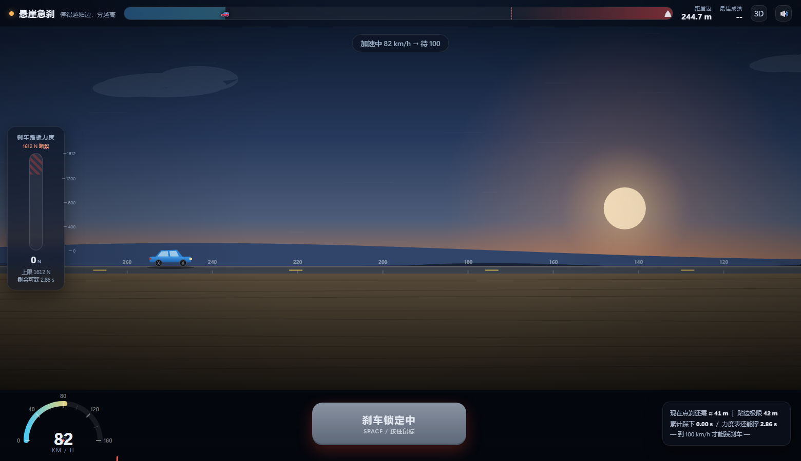
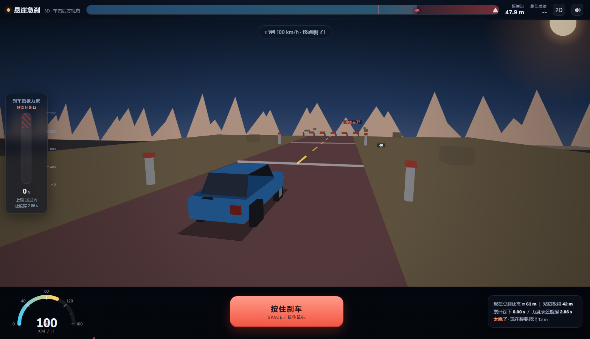
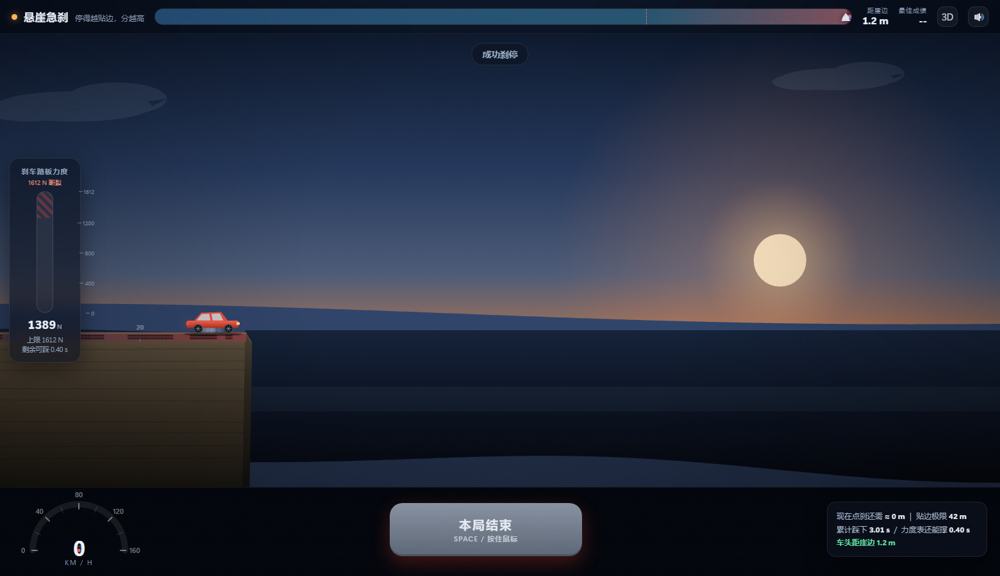
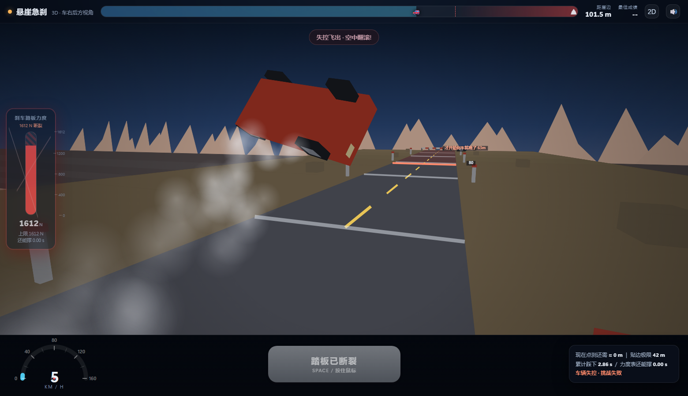

# 悬崖急刹 (Cliff Brake)

一个单页网页小游戏：车在有限长度的路上自动加速到 100 km/h，路尽头是悬崖。
把车在崖边刹停就赢，停得越贴边分越高；刹不住掉下去就输。
不要重刹，刹车太重会断，车毁人亡！！！

**在线试玩**（免下载）：<https://monostar-14.github.io/cliff-brake/>　｜　
3D 版：<https://monostar-14.github.io/cliff-brake/index-3d.html>

**本地玩**：下载本仓库，双击 `index.html`，或双击 `悬崖急刹-单文件版.html`（单文件版可以直接发给别人）。
按住 <kbd>空格</kbd> 或按住底部红色按钮 = 踩刹车。

| 2D 横版 | 3D（车右后方追尾视角） |
|---|---|
|  |  |
|  |  |

两个版本玩法、数值、失败判定完全一致，共用同一份物理内核 `game.js`；页面右上角互相切换。

---

## 规则

> 一脚踩到底 = 必死。要**点刹**：踩住半秒多、松一下让力度表回落，反复点。

| 量 | 数值 | 说明 |
|---|---|---|
| 巡航速度 | 100 km/h | 加速到这个速度才解锁刹车按钮（速度 = 解锁门槛） |
| 刹车减速度 | 9.2 m/s² | 固定值（≈0.94g，真车感） |
| 够不够停 | 从 100 刹停需踩住 **3.02 s** | = v ÷ a |
| 理想刹停距离 | **41.9 m** | 一脚不松的最短距离 |
| 点刹刹停距离 | **≈59 m** | 0.6s 踩 / 0.3s 松的节奏（比一脚多滑 15~20 m） |
| 踏板力度累积 | **+564 N/s**（按住）/ **−204 N/s**（松开） | 力度表读数 |
| 断裂阈值 | **1612 N** | = 一脚不松 **2.86 s** |

关键就在 **2.86 < 3.02**：一脚踩到底，会在车停下前 0.16 秒（此时还剩约 5 km/h）把踏板踩断，
之后刹车彻底失效，车滚下悬崖。想活命只能点刹——松手期间力度回落、但车不减速，
所以点刹要比"一脚踩死"多滑 15~20 米（实测 59 m），**必须提前开始点刹**。

失败方式一共三种：① 刹车太晚 ② 全程不刹 ③ 一路死踩 / 乱松手把力度表顶到 1612 N。

**踏板一旦断裂 = 失败**：
① 抱死甩尾（地面，浓烟 + 火花 + 横向擦痕）→ ② 弹射飞出、空中翻滚（拖尾烟雾，镜头锁死）
→ ③ 砸回地面白闪尘爆（撞毁）或飞过崖边直坠峡谷。

## 计分

停在崖前 `margin` 米 → 得分 `100 − margin`（0~100 分）。
S ≥97 / A ≥90 / B ≥75 / C ≥40 / D 其他。历史最佳存在 localStorage。
